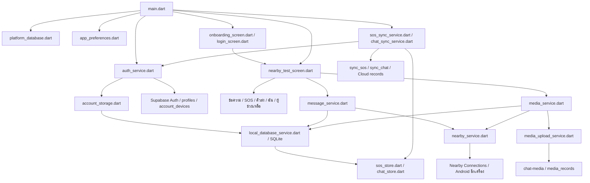
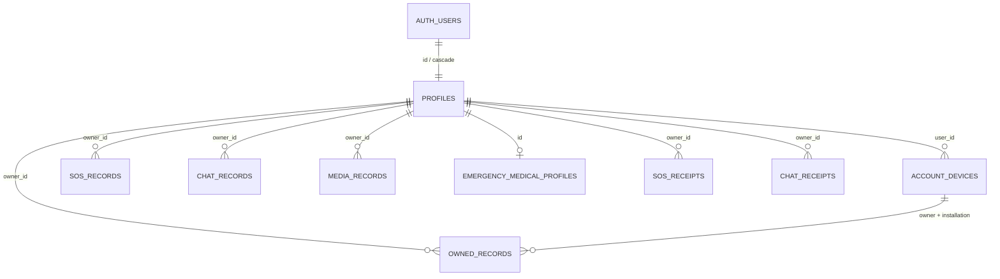

# RescueLink — อธิบายระบบและ Supabase จากโค้ดปัจจุบัน

วันที่ตรวจ: 10 ตุลาคม 2026 (Asia/Bangkok)

อ่านร่วมกับ [สารบัญไฟล์และการเชื่อมต่อ](APP_FILE_CATALOG_TH.md) ซึ่งแจกแจงไฟล์แอพทุกไฟล์ พร้อมชื่อคลาส/เมธอดที่สำคัญ import และไฟล์ที่เรียกใช้

## ขอบเขตและหลักฐาน

ตรวจ working tree ปัจจุบัน รวมไฟล์ที่แก้ไขและไฟล์ใหม่ที่ยังไม่ commit ไม่ได้ยึด README รุ่นเก่าเป็นข้อสรุปทั้งหมด ตรวจ Supabase จริงแบบอ่านอย่างเดียว: schema, policies, functions, migrations, จำนวนแถว และ Storage ไม่แสดงอีเมล ชื่อ เบอร์โทร ข้อความ หรือข้อมูลสุขภาพของสมาชิกจริง และไม่ได้แก้โค้ดแอพ/ฐานข้อมูลในการตรวจครั้งนี้

การมีโค้ดรองรับหมายถึงมี implementation อยู่ ไม่ได้ยืนยันว่าทำงานสำเร็จครบวงจรบนโทรศัพท์จริงทุกกรณี ผลทดสอบปัจจุบันอยู่ท้ายรายงาน

## 1. แอพนี้ทำอะไร

RescueLink เป็นแอพ Flutter/Dart สำหรับสื่อสารและขอความช่วยเหลือ โดยให้ Android ที่อยู่ใกล้กันติดต่อผ่าน Nearby Connections ใช้ Bluetooth/Wi-Fi ของเครื่อง แม้ไม่มีอินเทอร์เน็ต ส่วน Supabase ใช้สำหรับบัญชีผู้ใช้ ข้อมูลสมาชิก ข้อมูลสุขภาพส่วนตัว และสำรองประวัติบน Cloud

มีพื้นที่ข้อมูลสามส่วน: SQLite ในเครื่อง, Secure Storage สำหรับ session/ข้อมูลสุขภาพ และ Supabase บนอินเทอร์เน็ต

แอพใช้ Flutter/Dart มีเวอร์ชันใน pubspec `1.0.0+1` และเงื่อนไข Dart SDK `^3.12.2` ระบบแจ้ง UI ใช้ `ChangeNotifier`/`ListenableBuilder` และส่งบริการผ่าน constructor; การเปลี่ยนบัญชีเลือก database handle ใหม่เพื่อไม่ให้ callback เก่าปะปนข้อมูลอีกบัญชี

| Dependency ใน pubspec | ใช้กับส่วนไหน |
|---|---|
| `nearby_connections` | NearbyService ส่ง/รับ bytes และไฟล์ผ่านวิทยุ |
| `supabase_flutter` 2.17.2 | Auth, PostgreSQL Data API, RPC, Storage และ Edge Functions; โค้ดสร้าง SupabaseClient เองใน AuthBackend |
| `sqflite`, `sqflite_common_ffi_web` | ฐานข้อมูล SQLite native/เว็บ |
| `flutter_secure_storage` 11.2.0 | session, PKCE และ cache/คิวสุขภาพ |
| `permission_handler`, `device_info_plus`, `location` | ขอสิทธิ์ ตรวจ Android SDK และบริการตำแหน่ง; GPS capture จริงผ่าน Kotlin MethodChannel |
| `uuid`, `path`, `path_provider` | รหัสข้อความ/เหตุ/operation, จัด path และพื้นที่เก็บไฟล์ |
| `crypto` | SHA-256 ตรวจความครบของสื่อ |
| `file_picker`, `video_player` | เลือกไฟล์และเล่นวิดีโอ |
| `flutter_test`, `sqflite_common_ffi`, `flutter_lints` | ชุดทดสอบ ฐานข้อมูลจำลองในเครื่อง และกฎตรวจโค้ด |

`pubspec.yaml` เป็นข้อกำหนด dependency; `pubspec.lock` ระบุเวอร์ชันที่ resolve จริง ไม่ควรใช้ตัวเลข constraint ที่มี ^ เป็นหลักฐานว่าเครื่องรันเวอร์ชันต่ำสุดนั้นเสมอ

| ฟีเจอร์ | ทำอะไรได้ในโค้ดปัจจุบัน | เงื่อนไข/ข้อจำกัด |
|---|---|---|
| เริ่มใช้งาน | Onboarding, Login, สมัครสมาชิก 3 ขั้นตอน | ไม่มีปุ่ม Guest ใน Login ปัจจุบัน |
| บัญชี | สมัครด้วยอีเมล/รหัสผ่าน, ส่งอีเมลยืนยันซ้ำ, Login/Logout, จำ session | การสมัคร/Login ใหม่ต้องติดต่อ Supabase |
| ลืมรหัสผ่าน | ส่งอีเมล recovery, รับรหัสหรือ token แล้วตั้งรหัสใหม่ | การส่งอีเมลจริงและขั้นตอนข้ามแอพยังต้องทดสอบจริง |
| ใช้งานออฟไลน์ | กู้ session ของบัญชีที่เคยยืนยันอีเมลและ Login สำเร็จ | กรณีเน็ตขัดข้องอนุญาตงาน local; Cloud ต้อง refresh token ได้ |
| ใกล้ฉัน | ค้นหา ประกาศตัว เชื่อมต่ออัตโนมัติ รายชื่อ/สถานะ และแผนภาพพิกัด | Nearby ถูกจำกัดไว้ที่ Android; ไม่ใช่ค้นหาผู้ใช้ทุกคนบนอินเทอร์เน็ต |
| แชต | ส่งข้อความ, ประวัติ, ค้นหาบทสนทนา, จำนวนยังไม่อ่าน, ส่งซ้ำ | Delivered คือเครื่องรับบันทึกและตอบ ACK ไม่ใช่อ่านแล้ว |
| ส่งต่อหลายเครื่อง | Relay ข้อความ/SOS/สื่อผ่านเครื่องกลาง พร้อมคิวและ ACK | เส้นทางจำกัด 8 hops, ต้องมีเครื่องกลาง/การเชื่อมต่อที่ใช้ได้ |
| สื่อ | เลือกรูป/วิดีโอ ส่ง รับ ดูเต็มจอ และตรวจ SHA-256 | ส่งตรงสูงสุด 50 MiB; ผ่าน relay สูงสุด 5 MiB |
| SOS | ระบุชื่อ จำนวนคน ประเภท รายละเอียด แนบ GPS ได้ ส่ง แก้ไข ยกเลิก | SOS มีอายุ 24 ชั่วโมงจาก updatedAt; ไม่ได้แนบสุขภาพส่วนตัวอัตโนมัติ |
| ประวัติ SOS | ดูเหตุของตนเอง แก้ไข/ลบเหตุที่ยุติแล้ว | การลบ Cloud ใช้ deleted marker; เหตุที่ปิดแล้วไม่เปิดคืนด้วย record เดิม |
| ผู้ช่วยเหลือ | เปิด/ปิด Rescue mode ดูเหตุและพิกัด ติดต่อผู้แจ้งผ่านแชต | ไม่มีระบบรับเคสหรือจัดสรรงาน; สถานะเหตุอ้างอิง SOS ของผู้แจ้ง |
| คิวส่ง | แสดงรอ ACK/ถึงเครื่องรับ/ซิงก์แล้ว และรายละเอียดเส้นทาง | แท็บ synced ยังไม่ได้ผูกกับผล Chat/SOS Cloud Sync โดยตรง |
| Cloud Sync | ประวัติข้อความตัวอักษรและ SOS, retry, conflict resolution | ลองทุก 15 วินาทีระหว่าง runtime ทำงานและเมื่อ resume; ไม่ใช่บริการแชตออนไลน์ |
| Media Cloud | ผู้ใช้เลือกอัปโหลดไฟล์ ตรวจไฟล์บน Cloud เปิดผ่าน signed URL | คิวที่กู้หลังเปิดแอพต้องเลือกอีกครั้ง; retry เฉพาะงานเลือกใน session นี้ |
| สมาชิก | อ่าน/แก้ชื่อ, ชื่อร่างในเครื่อง, ลบบัญชีด้วยรหัสผ่าน | ชื่อร่างไม่ได้ส่ง Cloud อัตโนมัติ ต้องกดบันทึกสมาชิกเมื่อออนไลน์ |
| ข้อมูลสุขภาพ | ข้อมูลส่วนตัว กรุ๊ปเลือด โรคประจำตัว แพ้ยา ยาที่ใช้ ผู้ติดต่อฉุกเฉิน ความยินยอม | เจ้าของอ่านได้เท่านั้น; cache/คิวใช้ Secure Storage แยกจาก SQLite |
| ตั้งค่า | ไทย/อังกฤษ, สว่าง/มืด/ตามระบบ, เปิดปิดแจ้งเตือน | แปลบางหน้าหรือข้อความจาก service ยังไม่ครบ; preference แจ้งเตือนเป็นสวิตช์ร่วม |

## 2. การเชื่อมต่อไฟล์และเส้นทางหลัก

### เมื่อเปิดแอพ

1. `main.dart` เรียก `configurePlatformDatabase()` แล้วเปิด `RescueLinkApp`.
2. `AuthService.initialize()` อ่าน session จาก Secure Storage และให้ `AccountStorage` เลือก SQLite ของบัญชีที่ถูกต้อง.
3. โหลด `AppPreferences`; เริ่ม `SosSyncCoordinator` และ `ChatSyncCoordinator`.
4. ถ้ามี session เปิด `NearbyTestScreen`; ถ้าไม่มีเปิด Onboarding แล้ว Login.
5. `NearbyTestScreen` เป็นหน้าหลักจริง แม้ชื่อไฟล์มีคำว่า test สร้าง NearbyService, MessageService, MediaService และเริ่มค้นหาใกล้เคียง.
6. เมนูหลักมี 5 แท็บ: ใกล้ฉัน, ข้อความ, SOS, คิวส่ง, ฉัน. หน้า Responder เปิดจากเมนูฉัน.

### เมื่อส่งข้อความ A → B

`chat_screen.dart` → `MessageService.sendTextMessage()` → บันทึก `messages` และประวัติ/คิว `chat_records + chat_queue` → `NearbyService.sendMessage()` → เครื่อง B → บันทึกลง SQLite → ตอบ ACK → A เปลี่ยนเป็น delivered.

ถ้าไม่มี B โดยตรง แต่รู้เส้นทางผ่าน C จะห่อ `RelayPacket` และใช้ `relay_queue` กับ `relay_ack_queue` เก็บงานข้ามการเปิดปิดแอพ ป้องกันวนซ้ำด้วยเส้นทางและ `relay_seen` ACK เดินทางกลับตาม route. การรับ ACK ไม่ได้ยืนยันว่าผู้ใช้ปลายทางอ่านหรือรับผิดชอบเหตุแล้ว

สำหรับข้อความ/SOS คิวสามารถเลือกส่งต่อให้เพื่อนบ้านที่ไม่อยู่ในเส้นทางเดิมเมื่อไม่มีปลายทางตรง; สื่อเลือก hop ตาม route ที่รู้. คิว relay/ACK มี cleanup อายุ 48 ชั่วโมง ขณะ SOS active มีอายุ 24 ชั่วโมงตามข้อมูลเหตุ จึงเป็นเวลาคนละกติกา

### เมื่อส่ง SOS

`sos_screen.dart` → `sos_location_service.dart` (หากขอพิกัด) → `MainActivity.kt` → `LocationCapture.kt` → สร้าง `SosAlert` → `MessageService.publishSos()` → บันทึก SOS และข้อความใน transaction → ส่งผ่าน Nearby/Relay พร้อมเผยแพร่สถานะ presence → `SosSyncService` สำรองเหตุของเจ้าของไป Supabase แยกอีกทาง.

ประเภทบน wire/schema มี `medical`, `trapped`, `supplies`, `other`. ตัวเลือกน้ำท่วม/ไฟไหม้/อุบัติเหตุในหน้าจอใช้ `other` และใส่ชื่อประเภทในรายละเอียด เพื่อรองรับโครงสร้างเดิม

### เมื่อกดซิงก์

`sos_store.dart` หรือ `chat_store.dart` เก็บข้อมูลและคิวในเครื่อง → sync service ขอ client จาก `AuthService.cloudClient(owner)` → refresh session ตามจำเป็น → RPC ส่ง `operation_id`, `record_id`, `base_version`, payload และสถานะลบ → เซิร์ฟเวอร์ตรวจเจ้าของ/เวอร์ชัน → ตอบ applied หรือ conflict → local acknowledge/เก็บ conflict → ดึง records ของบัญชีตนเองกลับมาทีละ 200 แถว.

`operation_id` ทำให้ retry คำขอเดิมไม่เขียนซ้ำ; `base_version` ป้องกันเครื่องหนึ่งเขียนทับอีกเครื่องโดยไม่รู้ตัว. ผู้ใช้เลือกใช้ข้อมูลเครื่องหรือ Cloud เมื่อขัดแย้ง. Tombstone หรือ `deleted=true` ช่วยไม่ให้ record ที่ลบกลับมาเพราะอุปกรณ์เก่าซิงก์

### เมื่อส่งรูป/วิดีโอ

`ChatScreen` → `MediaService.pickAndSend()` → คัดลอกไฟล์เข้าพื้นที่แอพ → คำนวณ checksum → บันทึก metadata → ส่ง header `mediaInit` และ FILE payload → ผู้รับตรวจขนาด/hash แล้วบันทึกไฟล์ → ตอบ `MediaAck`.

การ Upload Cloud เป็นอีกขั้นที่ผู้ใช้เลือก: `MediaUploadService.enqueue()` → bucket `chat-media/<owner>/<mediaId>` → ดาวน์โหลดกลับตรวจขนาด/hash → upsert `media_records` → เปิดด้วย signed URL อายุ 60 วินาที. สถานะส่ง Nearby กับสถานะ Upload เป็นคนละชุด

### สมาชิกและสุขภาพ

`register_screen.dart` → `auth_service.dart` → Supabase Auth → trigger สร้าง `profiles`. ข้อมูลทั่วไปบางส่วนอยู่ Auth metadata ระหว่างสมัคร แต่ข้อมูลสุขภาพแยกเก็บใน `EmergencyProfileStore`.

`emergency_profile_screen.dart` → `SupabaseEmergencyProfileRepository` → `EmergencyProfileStore` → Secure Storage → `save_rescue_profile` → `profiles` และ `emergency_medical_profiles` ใน transaction เดียว. ถ้าออฟไลน์เก็บ pending และลองเมื่อมี Cloud access อีกครั้ง การถอนความยินยอมจากแอพทำให้ `save_rescue_profile` ลบแถวสุขภาพเมื่อซิงก์สำเร็จ

### ลบบัญชี

`member_screen.dart` → `SupabaseMemberRepository.deleteAccount(password)` → Edge Function `delete-account` → ตรวจ JWT และรหัสผ่านใหม่ → ลบ Storage ของผู้เรียก → revoke sessions → ลบ Auth user → FK cascade ลบข้อมูลลูก → แอพออกจากบัญชี ลบ secure profile และ SQLite ของบัญชี.

โค้ดไม่ได้ลบไฟล์รูป/วิดีโอที่ดาวน์โหลดไว้ใน Android เป็นรายไฟล์ในขั้นตอนนี้ และไม่ได้ลบสำเนาข้อความบนเครื่องคู่สนทนา

## 3. Supabase จริงมีอะไรบ้าง

โปรเจกต์: **RescueLink**, ref `yrpqhupqbzymesknalnq`, region `ap-southeast-1`, สถานะที่ตรวจ `ACTIVE_HEALTHY`, PostgreSQL 17.

`config/supabase.local.json` มี URL ตรงกับโปรเจกต์นี้และ public/publishable key. `tool/flutter.ps1` โหลดค่าระหว่าง build/run เป็น Dart defines. `auth_service.dart` อ่าน `SUPABASE_URL` และ `SUPABASE_PUBLISHABLE_KEY`. ไม่ต้องนำ service-role key มาใส่ในแอพ; Edge Function อ่านสิทธิ์ admin จาก environment ฝั่งเซิร์ฟเวอร์

### ตารางและจำนวนแถว ณ เวลาตรวจ

| Schema / ตาราง | จำนวนจริง | เก็บอะไร | ไฟล์/ทางเชื่อมหลัก |
|---|---:|---|---|
| `auth.users` | 3 | บัญชี Auth, identity, ข้อมูลยืนยันอีเมล | `auth_service.dart` ผ่าน Supabase Auth API; แอพไม่อ่านตารางตรง |
| `public.profiles` | 3 | ชื่อแสดง ชื่อจริง เบอร์ วันเกิด การยอมรับเงื่อนไข | `auth_service.dart`, `member_service.dart`, `emergency_profile_service.dart`, `save_rescue_profile` |
| `public.account_devices` | 8 | บัญชีผูก installation ID กับ radio identity และเวลาใช้งาน | `SupabaseAuthBackend.linkInstallation()` |
| `public.owned_records` | 0 | envelope message/SOS จากโครงสร้างระยะแรก | ไม่พบการเรียกใน `lib`; ปัจจุบันใช้ตารางเฉพาะแยกแล้ว |
| `public.sos_records` | 3 | payload SOS, version, deleted, updated_at | `sos_sync_service.dart` อ่าน; `sync_sos` เขียน |
| `public.chat_records` | 6 | ประวัติข้อความตัวอักษรส่วนตัวของบัญชี | `chat_sync_service.dart` อ่าน; `sync_chat` เขียน |
| `public.media_records` | 0 | ชื่อไฟล์ ประเภท ขนาด checksum และ message ID | `media_upload_service.dart` หลัง verify |
| `public.emergency_medical_profiles` | 1 | ข้อมูลสุขภาพ ผู้ติดต่อฉุกเฉิน และ consent | `emergency_profile_service.dart` อ่าน; `emergency_profile_store.dart` เรียก RPC |
| `sync_private.sos_receipts` | 7 | request/response ตาม operation ID ป้องกันซิงก์ซ้ำ | `sync_private.apply_sos` ใช้ภายใน |
| `sync_private.chat_receipts` | 9 | request/response ตาม operation ID ของแชต | `sync_private.apply_chat` ใช้ภายใน |

SOS 3 แถวรวม `deleted=true` 1 แถว จึงเหลือ 2 แถวที่ไม่ทำเครื่องหมายลบ; chat 6 แถวรวมลบ 1 แถว เหลือ 5 แถว. ตัวเลขนี้ไม่เท่ากับจำนวนเหตุที่ยัง active และไม่ใช่จำนวนข้อความที่พิสูจน์ว่าส่งถึงเครื่องรับ เพราะเราไม่ได้ใช้การนับแถวเป็นหลักฐานการส่งจริง

`account_devices` 8 แถวคือ 8 คู่บัญชี–installation ไม่ใช่หลักฐานว่ามีโทรศัพท์จริง 8 เครื่อง

### คอลัมน์สำคัญ

- `profiles`: `id`, `display_name`, `created_at`, `full_name`, `phone`, `date_of_birth`, `terms_version`, `terms_accepted_at`.
- `account_devices`: `user_id`, `installation_id`, `radio_identity`, `linked_at`, `last_seen_at`.
- `owned_records`: `owner_id`, `id`, `installation_id`, `kind`, `payload`, `revision`, `created_at`, `deleted_at`.
- `sos_records` / `chat_records`: `owner_id`, `id`, `payload`, `version`, `deleted`, `updated_at`.
- SOS payload: `version`, `incidentId`, `revision`, `active`, `name`, `people`, `category`, `details`, `updatedAt`, `location` โดย location มี `latitude`, `longitude`, `accuracy`, `capturedAt`.
- Chat payload: `id`, `senderId`, `senderName`, `receiverId`, `text`, `timestamp`, `type`, `status`, `ackFor`. Cloud Sync รับชนิด `message` เท่านั้น.
- `media_records`: `owner_id`, `id`, `message_id`, `file_name`, `mime_type`, `file_size`, `checksum`, `created_at`.
- `emergency_medical_profiles`: `id`, `blood_group`, `rh_factor`, `medical_conditions`, `allergies`, `medications`, `medical_notes`, `emergency_contact_name`, `emergency_contact_phone`, `emergency_contact_relation`, `health_consent`, `consent_at`, `created_at`, `updated_at`.
- ตาราง receipts ทั้งสอง: `owner_id`, `operation_id`, `request`, `response`. Receipt นี้เป็นผลซิงก์ Cloud คนละอย่างกับ Nearby delivery ACK.

### ความสัมพันธ์ข้อมูล

`profiles.id` เป็น Auth user UUID ส่วน `radio_identity` เป็นตัวตนของการสื่อสาร Nearby ไม่ควรถือว่า `MessageModel.senderId` คือ Supabase Auth UID. ข้อมูล Cloud มี `owner_id` แยกไว้ควบคุมว่าเป็นประวัติของบัญชีใด

`media_records.message_id` เป็นข้อมูลอ้างอิงระดับแอพ ไม่พบ foreign key ไป `chat_records`; ไฟล์จริงอยู่ Storage และ metadata อยู่ PostgreSQL แยกกัน

### Functions และ trigger

| ชื่อ | ใครเรียก / หน้าที่ |
|---|---|
| `public.sync_sos` | Flutter `SupabaseSosCloud.push()` เรียกผ่าน RPC |
| `sync_private.apply_sos` | ตรวจ auth.uid, payload, operation เดิม, version, การปิด/ลบ แล้วบันทึก record + receipt |
| `public.sync_chat` | Flutter `SupabaseChatCloud.push()` เรียกผ่าน RPC |
| `sync_private.apply_chat` | ตรวจเจ้าของ ชนิดข้อความ ความยาว version และ request ซ้ำ ก่อนเขียนประวัติ |
| `public.save_rescue_profile` | `EmergencyProfileStore.sync()` เรียกเพื่อบันทึกทั่วไปและสุขภาพอย่างสัมพันธ์กัน |
| `public.upsert_emergency_medical_profile` | ถูกเรียกใน `save_rescue_profile` เมื่อยินยอมเก็บสุขภาพ |
| `public.withdraw_health_consent` | มีใน DB; ล้างช่องสุขภาพและเก็บแถวไว้ แต่ flow ปัจจุบันของ Flutter ใช้ `save_rescue_profile` ซึ่งลบแถว |
| `private.create_member_profile` | trigger หลังสร้าง Auth user สร้างข้อมูลสมาชิกทั่วไป |
| `private.set_updated_at` | trigger ก่อนแก้ไขแถวสุขภาพ กำหนดเวลาอัปเดต |
| `public.rls_auto_enable` | function สนับสนุนการเปิด RLS ของฐานข้อมูล ไม่พบ Flutter เรียก |
| Edge `delete-account` | `member_service.dart` เรียกผ่าน Functions API; สถานะ deployed ACTIVE v1 และ verify_jwt=true |

### Storage / Realtime / สิทธิ์

- มี bucket `chat-media` แบบ **private** ขนาดสูงสุด 52,428,800 bytes (50 MiB). รองรับ JPEG, PNG, GIF, WebP, HEIC และวิดีโอ MP4, QuickTime, AVI, Matroska, WebM, 3GPP ตาม MIME ที่กำหนด.
- ณ เวลาตรวจ bucket ไม่มี object และ `media_records` ไม่มีแถว จึงยืนยันได้ว่ามีระบบรองรับ แต่ไม่มีไฟล์ Cloud คงอยู่ให้ตรวจใน snapshot นี้.
- ทุกตาราง `public` ที่พบเปิด RLS. Profiles/สุขภาพใช้ `auth.uid() = id`; device ใช้ `user_id`; records ใช้ `owner_id`.
- `sos_records` และ `chat_records` ให้ client อ่านของตนเองและเขียนผ่าน RPC เพื่อบังคับกติกา version/receipt. ตาราง receipts ไม่เปิดให้ client อ่านเขียนโดยตรง.
- Storage policy ให้เข้าถึงเฉพาะโฟลเดอร์ชั้นแรกที่ตรงกับ Auth UID ครบ SELECT/INSERT/UPDATE/DELETE.
- ไม่พบการ subscribe Supabase Realtime ใน `lib` และไม่มี table ใน publication `supabase_realtime` ตอนตรวจ. Presence/Relay ของแอพใช้ Nearby; Cloud Sync ใช้การเรียกตามรอบ.
- ไม่พบการใช้งาน Supabase Vector, Edge ส่งข้อความ, หรือ Push Notification ในเส้นทางหลักที่ตรวจ. แอพมี Android local notifications ของตนเอง.

## 4. ข้อมูลในเครื่อง

| ที่เก็บ | ข้อมูล/หน้าที่ |
|---|---|
| `accounts.db`: `installation`, `owners` | รหัสติดตั้ง และบัญชีจับคู่ไฟล์ SQLite |
| SQLite ของแต่ละบัญชี: `settings` | preferences, ชื่อ cache/ร่าง, mySos, directory, remote SOS, route, mediaUploadQueue, บันทึก responder ฯลฯ |
| `peers` | UUID และชื่อคู่สนทนา |
| `messages` | ข้อความ/SOS/media envelope สถานะส่ง และเวลาในเครื่อง |
| `relay_seen` | ป้องกันประมวลผล packet ซ้ำ |
| `relay_queue` | เก็บ packet รอส่งต่อ ข้อมูล retry/ปลายทาง/ACK |
| `relay_ack_queue` | เก็บ ACK รอเส้นทางกลับ |
| `media_files` | metadata ไฟล์, localPath, ขนาด/hash, progress/status |
| `sos_records`, `sos_queue` | ประวัติ SOS ของตนและคิว Cloud |
| `chat_records`, `chat_queue` | สำเนาประวัติข้อความส่วนตัวและคิว Cloud |
| Secure Storage | serialized session, PKCE verifier, ข้อมูลส่วนตัว/สุขภาพที่ cache หรือ pending |
| ไฟล์สื่อในพื้นที่แอพ | bytes จริงของภาพและวิดีโอ; SQLite เก็บแค่ path/metadata |

SQLite เวอร์ชัน schema ปัจจุบันคือ 9. SQLite ไม่ได้ใช้ SQLCipher ใน dependencies ที่ตรวจ จึงไม่ควรอธิบายว่าแชต/SOS ในเครื่องทั้งหมดถูกเข้ารหัสด้วยฐานข้อมูล แอพใช้ Secure Storage เฉพาะข้อมูลที่แยกไปเก็บตามที่กล่าวข้างต้น

บนเว็บ `platform_database.dart` เลือก `platform_database_web.dart` ให้ใช้ SQLite WASM/worker; native ใช้ค่า database factory เดิม. การมี platform folders ของ Flutter ไม่ได้ยืนยันว่า Nearby/GPS ทำงานบนทุก platform

## 5. Android native เชื่อม Flutter อย่างไร

| ไฟล์ | หน้าที่และทางเชื่อม |
|---|---|
| `MainActivity.kt` | ลงทะเบียน MethodChannel location/session/maps, เปิด service, ตรวจ Wi-Fi, local notification และนำทางเมื่อกด notification |
| `LocationCapture.kt` | รับ capture/cancel อ่านตำแหน่งจาก native provider/Fused location ตรวจความสดและ timeout พร้อม diagnostics |
| `ConnectionService.kt` | foreground connected-device service พร้อม notification และ WakeLock เพื่อช่วยคงการเชื่อมต่อ; START_NOT_STICKY |
| `AndroidManifest.xml` | permissions Internet/Bluetooth/Wi-Fi/Location/notification/foreground service, activity/service และปิด allowBackup |

`sos_location_service.dart` คุย channel `com.rmutt.rescuelink/location`; `connection_session.dart` และ `permission_service.dart` คุย `com.rmutt.rescuelink/session`. Nearby bytes/file transfer ใช้ plugin `nearby_connections`.

เมื่อแอพอยู่เบื้องหลังและ foreground service เริ่มสำเร็จ โค้ดอนุญาตให้ Nearby ทำงานต่อ ถ้าไม่ได้เริ่ม service จะหยุดเมื่อออก foreground. ยังต้องทดสอบข้อจำกัดแบตเตอรี่/การฆ่า process ของ Android จริง ไม่ควรสรุปจาก README Phase 1 ว่าปัจจุบันหยุดทุกครั้งที่ pause

## 6. ไฟล์ Supabase แต่ละชุด

| ไฟล์ migration | ผลต่อระบบ |
|---|---|
| `20260928152738_membership_foundation.sql` | profiles/account_devices/owned_records, owner RLS, trigger สร้างสมาชิก |
| `20260928153353_lock_internal_rls_function.sql` | ล็อกสิทธิ์ execute ของ rls_auto_enable |
| `20260929060828_sos_cloud_sync_verified.sql` | SOS records/receipts และ sync_sos/apply_sos |
| `20260930082212_sos_payload_validation.sql` | เพิ่มการตรวจชนิดข้อมูลตัวเลขใน SOS payload/พิกัด |
| `20260930153219_media_private_storage.sql` | media_records, private chat-media และ Storage policies |
| `20261008054140_chat_history_cloud_sync.sql` | chat records/receipts และ sync_chat/apply_chat |
| `20261009070000_emergency_medical_profiles.sql` | ขยาย profiles, ตารางสุขภาพ, consent RPC และ trigger |

มี migration จริง 7 รายการ แต่ version ของ media ในฐานข้อมูลเป็น `20260930153304` ขณะที่ไฟล์ใน repo เป็น `20260930153219` ชื่อ migration ตรงกัน ตรวจพบความต่างด้านประวัติ ไม่ได้เปลี่ยนหรือ repair ในงานนี้ และไม่ควรเอา migration เก่าไปรันซ้ำโดยไม่ตรวจ diff

`supabase/functions/delete-account/index.ts` เป็นโค้ด Edge Function. `supabase/templates/confirmation.html` และ `recovery.html` เป็นเทมเพลตอีเมลพร้อม README วิธีใช้; การมีไฟล์ใน repo ไม่ได้พิสูจน์ว่าค่า template/SMTP ใน Dashboard ตรงกัน

`supabase/tests/ownership.sql`, `sos_sync.sql`, `chat_sync.sql`, `media_storage.sql`, `emergency_medical_profiles.sql` เป็นสคริปต์ตรวจสิทธิ์และกติกาฐานข้อมูล ไม่ได้ถูกเรียกโดย Flutter ขณะใช้งานปกติ

## 7. ข้อสังเกตที่มีผลกับการอธิบาย/เดโมระบบ

1. Cloud chat เป็นประวัติส่วนตัว การแก้/ลบประวัติไม่แก้ข้อความที่อีกฝ่ายได้รับไปแล้ว และไม่ได้ทำให้คนอยู่ไกลส่งแชตหากันทางอินเทอร์เน็ต.
2. SOS Cloud อ่านได้เฉพาะเจ้าของ จึงยังไม่ใช่ศูนย์รับเหตุออนไลน์ที่ผู้ช่วยเหลือทุกคนเห็นเหตุทั้งหมด.
3. Rescue mode เป็นการประกาศความพร้อมด้วยตนเอง ไม่มีตาราง verified responder/องค์กรหรือสิทธิ์ผู้ช่วยเหลือที่ได้รับการรับรอง.
4. ยกเลิกระบบรับเคสและบันทึกกำลังช่วยเหลือ/เสร็จสิ้นแล้ว (19 ต.ค. 2569) หน้ากู้ภัยใช้ดู SOS และติดต่อผ่านแชต บันทึกเก่าใน settings ไม่ถูกนำมาแสดงสถานะเหตุ และประวัติข้อความเดิมยังอ่านได้.
5. แผนที่ในแอพเป็นแผนภาพพิกัด/กริดที่วาดเอง ไม่มีถนน/route navigation ของจริงในแผนภาพนั้น.
6. `DemoFeaturesScreen` เป็นหน้าจำลองแยก ไม่มีข้อมูลจริง และไม่พบการเปิดจากเส้นทางหน้าหลักปัจจุบัน. `SosRadar` กับ `DeviceTile` มี implementation/test แต่ไม่พบผู้เรียกจาก production Dart อื่น; หน้าหลักปัจจุบันใช้ `NearbyMiniMap`/รายการที่สร้างในหน้า.
7. มี enum `synced` ในคิวส่ง แต่ Chat/SOS Cloud acknowledge อัปเดต store ของตนเอง ไม่ได้เปลี่ยน delivery status ของ `messages` ให้ synced โดยอัตโนมัติ. ไม่ควรใช้แท็บนี้ตัดสินว่า Cloud มีข้อมูลครบ.
8. มี auto-accept connection และ TODO ให้ผู้ใช้ approve/reject ใน `nearby_service.dart`; การ Login Supabase ไม่เท่ากับการยืนยันตัวตนของทุก peer ผ่านวิทยุ.
9. หน้า Login/main ปัจจุบันพาเข้า NearbyTestScreen ทั้งคู่ ไม่มีการแยกเว็บไป MemberScreen อัตโนมัติเหมือนคำอธิบายบางส่วนใน README. Nearby permission service ปฏิเสธ platform ที่ไม่ใช่ Android.
10. English preference ยังไม่ครอบคลุมข้อความทั้งหมด มี label และ error ไทยที่เขียนตรงในหลายหน้า.
11. Media upload retry สูงสุด 5 attempts และใช้ backoff; pending หลังเปิดแอพใหม่จะไม่อัปโหลดจนเลือกงานอีกครั้ง ตาม `_selectedThisSession`.
12. ข้อมูลบน server ที่นับได้อาจเป็นข้อมูลทดสอบหรือใช้งานจริง การตรวจครั้งนี้ไม่ได้จัดประเภทหรืออ่านเนื้อหาส่วนตัว.

Supabase security advisor พบคำเตือน **Leaked Password Protection Disabled** และรายการระดับ INFO ว่า `sync_private.chat_receipts` เปิด RLS แต่ไม่มี policy. กรณี receipts โค้ด migration ตั้งใจ revoke direct access และใช้ guarded function จึงไม่ใช่หลักฐานว่าข้อมูลเปิดสาธารณะจากคำเตือนนี้เพียงอย่างเดียว ดู [Password protection](https://supabase.com/docs/guides/auth/password-security#password-strength-and-leaked-password-protection) และ [RLS enabled without policy](https://supabase.com/docs/guides/database/database-linter?lint=0008_rls_enabled_no_policy).

## 8. ผลตรวจครั้งนี้

| การตรวจ | ผลปัจจุบัน |
|---|---|
| Flutter analyze --no-pub | พบ 3 issues: warning ตัวแปรสี `darkBlue` และ `peach` ไม่ได้ใช้ที่ responder_screen.dart:28,30; info `activeColor` deprecated ที่บรรทัด 849; exit code 1 |
| Flutter test --no-pub --reporter expanded | ผ่าน 180, ข้าม 5, ไม่ผ่าน 1; ดู `tmp/app-audit-verified-tests.log` |
| Node tests ของ delete-account | ผ่าน 8/8; ใช้ mocked API ไม่ได้ลบบัญชีจริง |
| Supabase metadata + SELECT counts/policies | อ่านได้สำเร็จและยืนยันตาราง/จำนวนตามรายงาน |
| Android P2P/GPS/notifications บนอุปกรณ์จริง | ไม่ได้ทดสอบในรอบนี้ |

เทสต์ที่ไม่ผ่านคือ `test/sos_screen_test.dart:108` ชื่อ `Rescue card displays SOS details and opens sender chat`: ตัวทดสอบคาดว่าจะพบข้อความ “3 คน” หนึ่งจุด แต่ UI มีสองจุด จึงหยุดก่อนยืนยันขั้นตอนถัดไป. ข้อนี้เป็นความไม่ตรงกันระหว่างตัวทดสอบกับ UI ยังไม่ใช่หลักฐานว่า Nearby หรือการส่งแชตเสีย

5 เทสต์ที่ข้ามเป็นเทสต์ live ซึ่งต้องเปิด flag/ข้อมูลบัญชีภายนอกอย่างชัดเจน ผล 180 ที่ผ่านจึงไม่แทนการทดสอบส่งอีเมล/Cloud แบบผู้ใช้ครบวงจรหรือมือถือจริง. การตรวจครั้งนี้ไม่ได้แก้ warning/test หรือฟังก์ชันแอพ เพราะโจทย์เป็นการสำรวจและอธิบาย

การตรวจฐานข้อมูลเป็นแบบ read-only ไม่ได้สมัคร/ลบบัญชี ส่งอีเมล ส่ง SOS หรืออัปโหลดไฟล์จริง ไม่ได้ทดสอบ Android สอง/สามเครื่องในรอบนี้. สารบัญแยกมี Dart 62 ไฟล์และไฟล์ประกอบ 249 ไฟล์ตามขอบเขตที่ระบุ ไม่รวมสองรายงานที่สร้างในรอบนี้
