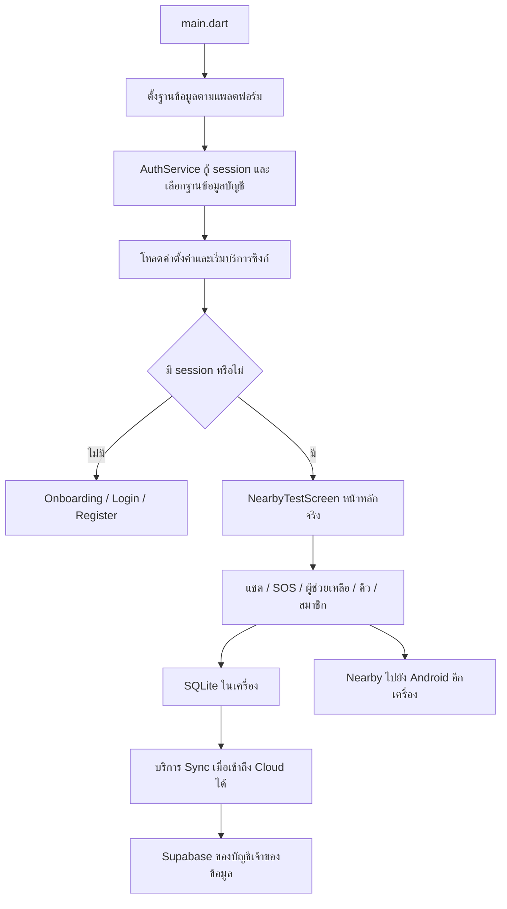

# คู่มือศึกษาโปรเจกต์ RescueLink ก่อนส่งอาจารย์

วันที่จัดทำ: 28 ตุลาคม 2569 (2026) จากไฟล์ใน working tree ปัจจุบัน รวมงานที่ยังไม่ commit

เอกสารนี้อธิบายโค้ดและการใช้งาน ไม่ใช่การรับรองผลบนโทรศัพท์หรือ Supabase จริงในวันที่จัดทำ ผลเก่าในเอกสารอื่นต้องอ่านพร้อมวันที่ โดยเฉพาะ README ที่รวมประวัติหลายรุ่น

## 1. อธิบายโปรเจกต์ให้เข้าใจในหนึ่งนาที

**RescueLink เป็นแอปสำหรับสื่อสารและแจ้งขอความช่วยเหลือระหว่างโทรศัพท์ Android ที่อยู่ใกล้กัน แม้ไม่มีอินเทอร์เน็ต โดยใช้ Nearby Connections พร้อมเก็บข้อมูลในเครื่อง และซิงก์ข้อมูลส่วนตัวขึ้น Supabase เมื่อออนไลน์**

ปัญหาที่ต้องการแก้คือ เมื่ออินเทอร์เน็ตใช้ไม่ได้ ผู้ใช้ยังต้องแจ้งเหตุ ส่งพิกัด และติดต่อคนใกล้เคียงได้ แอปมีแชต ข้อความ SOS รูป/วิดีโอ โหมดผู้ช่วยเหลือ แผนที่ออฟไลน์ และคิวส่งซ้ำ

ข้อจำกัดสำคัญ: ต้องมีเครื่องที่ติดตั้งแอปและเชื่อมต่อถึงกันโดยตรงหรือผ่านเครื่องกลาง ไม่ใช่ส่งได้ทุกระยะ ไม่ได้เชื่อมศูนย์ฉุกเฉินโดยอัตโนมัติ และการสมัคร/เข้าสู่ระบบครั้งแรกต้องมีอินเทอร์เน็ต

## 2. เทคโนโลยีแต่ละตัวทำอะไร

| ส่วน | เทคโนโลยี | หน้าที่ในงานนี้ |
|---|---|---|
| หน้าจอและตรรกะหลัก | Flutter / Dart | สร้าง UI จัดการข้อมูลและบริการต่าง ๆ |
| งานเฉพาะ Android | Kotlin / MethodChannel | GPS, foreground service และการแจ้งเตือนที่เชื่อมกับ Flutter |
| สื่อสารใกล้เคียง | nearby_connections, P2P_CLUSTER | ค้นหา ประกาศตัว เชื่อมต่อ ส่ง bytes และไฟล์ |
| ข้อมูลในเครื่อง | SQLite / sqflite | ประวัติแชต เหตุ SOS คู่สนทนา และคิวถาวร |
| ข้อมูลที่ต้องป้องกันในเครื่อง | flutter_secure_storage | session, PKCE และ cache/คิวข้อมูลสุขภาพ |
| บัญชีและข้อมูล Cloud | Supabase Auth / PostgreSQL | สมาชิก การยืนยันตัวตน ประวัติและข้อมูลสุขภาพ |
| สื่อบน Cloud | Supabase Storage | ไฟล์ใน bucket ส่วนตัวชื่อ chat-media |
| ลบบัญชี | Supabase Edge Function / TypeScript | ตรวจผู้เรียกและรหัสผ่านก่อนลบบัญชี |
| แผนที่ | ข้อมูล OpenStreetMap ใน assets | แผนที่ออฟไลน์จังหวัดปทุมธานี |
| แจ้งให้ UI เปลี่ยนตามข้อมูล | ChangeNotifier / ListenableBuilder | หน้าจอรับรู้ว่าข้อมูลหรือสถานะเปลี่ยน |

`pubspec.yaml` ระบุ Dart SDK `^3.12.2`, รุ่นแอป `1.0.0+1`; รุ่น dependency ที่ติดตั้งจริงดู `pubspec.lock` ไม่ใช่อ่านเฉพาะเลขหลังเครื่องหมาย ^

## 3. ภาพรวมระบบและลำดับเมื่อเปิดแอป



1. `main()` ใน `lib/main.dart` เตรียม Flutter และเรียก `configurePlatformDatabase()`
2. `_StartupScreen` เรียก `AuthService.initialize()` เพื่อกู้ session และผูกพื้นที่ข้อมูลกับบัญชี
3. โหลด `AppPreferences` แล้วเริ่ม `SosSyncCoordinator`, `ChatSyncCoordinator`, `MemberProfileSync`
4. มี session ไป `NearbyTestScreen`; ไม่มี session ไป Onboarding แล้ว Login ไม่มีปุ่ม Guest ใน flow ปัจจุบัน
5. หน้าหลักประกอบบริการ Nearby, ข้อความ และสื่อ ก่อนผู้ใช้ทำงานผ่านหน้าจอต่าง ๆ

**ชื่อ `nearby_test_screen.dart` เป็นชื่อที่คงมาจากช่วงพัฒนา แต่เป็นหน้าหลักที่แอปเรียกใช้จริง ไม่ใช่ไฟล์ทดสอบอัตโนมัติ** ไฟล์ทดสอบอยู่ใน `test/`

## 4. เริ่มใช้งานตั้งแต่ศูนย์

1. ติดตั้งแอปรุ่นเดียวกันบน Android อย่างน้อยสองเครื่อง
2. ต่ออินเทอร์เน็ต สมัครบัญชี กรอกข้อมูลและยืนยันอีเมล แล้วเข้าสู่ระบบสำเร็จก่อนทดลองออฟไลน์
3. อนุญาตสิทธิ์ที่แอปขอเกี่ยวกับ Nearby/Bluetooth/Wi-Fi และตำแหน่งตามรุ่น Android
4. เปิด Bluetooth และ Wi-Fi; การไม่มีอินเทอร์เน็ตไม่ได้หมายความว่าปิดวิทยุทั้งหมด หากใช้โหมดเครื่องบินให้เปิดวิทยุที่จำเป็นกลับ
5. เปิดการค้นหา/เชื่อมต่อทั้งสองเครื่อง ตรวจสถานะว่าเชื่อมต่อแล้ว
6. เปิดแชต ส่งข้อความ และดูสถานะจนถึงเครื่องรับยืนยัน
7. ทดลอง SOS กรอกชื่อ จำนวนคน ประเภท รายละเอียด อ่าน GPS หรือปักตำแหน่ง ตรวจข้อมูลก่อนยืนยัน
8. อีกเครื่องดูเหตุและติดต่อกลับทางแชต สามารถเปิดโหมดผู้ช่วยเหลือและแชร์ตำแหน่งได้
9. เมื่อกลับมาออนไลน์ ตรวจคิวซิงก์และประวัติ Cloud ก่อนทดลองย้ายเครื่อง

บัญชีที่เคยยืนยันและเข้าสู่ระบบสำเร็จมี flow กู้ session สำหรับงานออฟไลน์ แต่ไม่ได้แปลว่าสมัครบัญชีใหม่หรือดาวน์โหลดประวัติ Cloud โดยไม่มีอินเทอร์เน็ตได้

## 5. ข้อความเดินทางอย่างไร

ตัวอย่าง A ส่ง “ต้องการน้ำดื่ม” ให้ B:

1. `chat_screen.dart` รับข้อความจากผู้ใช้
2. `message_service.dart` สร้างข้อมูลข้อความ มี UUID ผู้ส่ง ผู้รับ เนื้อหาและเวลา
3. บันทึกใน SQLite พร้อมข้อมูลประวัติ/คิวที่เกี่ยวข้องก่อนพยายามส่ง จึงมีข้อมูลไว้ลองใหม่
4. `nearby_service.dart` ส่งข้อมูลไปยังเครื่องที่เชื่อมต่อ
5. B บันทึกข้อความ แล้วส่ง ACK ซึ่งเป็นข้อความยืนยันกลับ
6. A รับ ACK และปรับสถานะเป็น delivered

| สถานะ | ความหมาย |
|---|---|
| pending | ยังรอการเชื่อมต่อ/การส่ง |
| sent | ส่งแล้วและรอเครื่องรับยืนยัน |
| delivered | เครื่องปลายทางบันทึกและตอบยืนยันแล้ว |
| synced | สถานะเกี่ยวกับการซิงก์ ต้องแยกจากการส่งผ่าน Nearby |

Delivered ไม่ใช่ read receipt และไม่ใช่การรับงานของเจ้าหน้าที่ ส่วน Cloud sync เป็นการสำรองประวัติของบัญชี ไม่ใช่การส่งข้อความผ่านอินเทอร์เน็ตไปหาอีกบัญชี

### ส่งผ่านเครื่องกลาง

กรณี A ไปไม่ถึง C แต่มี B เป็นทางผ่าน ระบบห่อข้อความด้วย `RelayPacket` เก็บเส้นทาง ส่งผ่าน B และส่ง ACK กลับตามเส้นทาง มี `relay_seen` ป้องกันรับซ้ำ และคิว relay/ACK เพื่อรอส่งภายหลัง

โค้ดจำกัด `maxHops = 8` เพื่อจำกัดการส่งต่อ ไม่ได้หมายความว่ารับประกันระยะทาง 8 เท่า จำนวนเครื่องและสภาพวิทยุจริงมีผล การทดสอบสามเครื่องต้องพิสูจน์ว่า A และ C ไม่ได้เชื่อมตรงด้วย

## 6. SOS และตำแหน่งทำงานอย่างไร

`sos_screen.dart` → `SosLocationService` ถ้าขอ GPS → Kotlin `LocationCapture` → สร้าง `SosAlert` → `MessageService.publishSos()` → เก็บและเผยแพร่ผ่าน Nearby/relay → สำรองเหตุของเจ้าของด้วย `SosSyncService`

ข้อมูลหลักใน `SosAlert`:

| ฟิลด์ | ความหมาย |
|---|---|
| incidentId | รหัสเหตุ |
| revision | ลำดับรุ่นของเหตุ ใช้บอกว่าข้อมูลใดใหม่กว่า |
| active | เหตุยังเปิดอยู่หรือไม่ |
| name / people | ชื่อผู้แจ้งและจำนวนผู้ต้องการความช่วยเหลือ |
| categories / category | ประเภทเหตุหลายรายการ และประเภทหลักเพื่อรองรับรุ่นเดิม |
| details | รายละเอียดเหตุ |
| updatedAt | เวลาแก้ไขเหตุล่าสุด |
| location | พิกัด ความแม่นยำ เวลาอ่าน และข้อมูลว่าปักเองหรือไม่; ไม่มีพิกัดก็ได้ |

ประเภทในรุ่นปัจจุบันมีเจ็บป่วย/บาดเจ็บ ติดอยู่ ต้องการอาหาร/น้ำ อื่น ๆ น้ำท่วม ไฟไหม้ และอุบัติเหตุ รุ่นเดิมรองรับเพียงสี่ประเภท จึงมี `legacyCategory` แปลงสามประเภทใหม่เป็น `other` พร้อมข้อมูล categories สำหรับรุ่นใหม่

โค้ดตรวจชื่อไม่ว่างและไม่เกิน 80 ตัวอักษร จำนวนคน 1–999 รายละเอียดไม่เกิน 1,000 ตัวอักษร พิกัดต้องอยู่ในช่วงที่ถูกต้อง เหตุ active มีอายุ 24 ชั่วโมงจาก `updatedAt`; การ relay ไม่ต่ออายุเหตุแทนเจ้าของ

เมื่อ GPS ใหม่ใช้ไม่ได้ ระบบรองรับพิกัดล่าสุดที่เก็บไว้และแสดงอายุของพิกัด หากไม่มีพิกัดยังส่ง SOS ได้ตามขั้นตอนยืนยัน ต้องอธิบายว่า “ไม่มีพิกัด” หรือ “พิกัดเก่า” ให้ตรงกับหน้าจอ ไม่อ้างว่าเป็น GPS สดทุกครั้ง

โหมดผู้ช่วยเหลือใช้ดูเหตุ แชร์ตำแหน่ง และติดต่อผู้แจ้ง ไม่ควรนำเสนอว่าเป็นระบบจัดสรรงานกู้ภัยหรือรับเคสอย่างเป็นทางการโดยไม่มีฟีเจอร์รองรับ

## 7. รูป วิดีโอ แผนที่ และการกู้คืนข้ามเครื่อง

**สื่อ:** `MediaService` คัดลอกไฟล์เข้าแอป เก็บ metadata ส่งส่วนหัวและไฟล์ ผู้รับตรวจขนาดและ SHA-256 ก่อนตอบรับ โค้ดจำกัดส่งตรง 50 MiB และส่งผ่าน relay 5 MiB ขนาด checksum ใช้ตรวจความครบของไฟล์ ไม่ควรอธิบายว่าเป็นการเข้ารหัสเนื้อหา

**สำรองสื่อ:** `MediaUploadService` ดูแลอัปโหลด/ตรวจไฟล์ใน `chat-media` และ metadata ใน `media_records` ประวัติข้อความกับ bytes ของรูปเป็นคนละส่วน ต้องอัปโหลดไฟล์สำเร็จด้วยจึงกู้รูปได้

**กู้ประวัติ:** รุ่นล่าสุดมี `archiveIdentity` และข้อมูลคู่สนทนาเพื่อรู้ว่าข้อความฝั่งใดเป็นของบัญชีที่เข้าสู่ระบบบนเครื่องใหม่ ครอบคลุมข้อความ สื่อ และ SOS ในห้องแชต โดยไม่ส่งข้อความเก่ากลับเข้า Nearby อีกครั้ง `chat_attachment_restore.dart` ดาวน์โหลดไฟล์ที่สัมพันธ์กับประวัติ ตรวจขนาด/hash และแยกโฟลเดอร์ตามบัญชี

**แผนที่:** `pubspec.yaml` ปัจจุบันบรรจุ `assets/maps/pathum/` เป็นแผนที่ออฟไลน์จังหวัดปทุมธานี `offline_tile_store.dart` โหลดข้อมูลเฉพาะพื้นที่และ `bundled_offline_map.dart` วาดแผนที่ ไฟล์ RMUTT เดิมยังอยู่ใน repo แต่ไม่ใช่ชุด assets หลักที่ระบุไว้ใน pubspec รุ่นนี้ แผนที่ออฟไลน์ไม่ได้ให้ข้อมูลถนนสดหรือการนำทางเลี้ยวต่อเลี้ยวโดยอัตโนมัติ

## 8. ข้อมูลทั้งหมดเก็บที่ไหน

### ในเครื่อง

| ที่เก็บ/ตาราง | ข้อมูล |
|---|---|
| accounts.db: installation, owners | รหัสติดตั้งและการจับคู่บัญชีกับไฟล์ฐานข้อมูล |
| settings | ค่าตั้งค่า ข้อมูลสถานะ/cache และคิวบางประเภทในรูปค่าตาม key |
| peers | รหัสและชื่อคู่สนทนา |
| messages | เนื้อหา/envelope ผู้ส่ง ผู้รับ เวลา ชนิดและสถานะข้อความ |
| relay_seen, relay_queue, relay_ack_queue | ป้องกันซ้ำ งานส่งต่อ และ ACK รอส่ง |
| media_files | path ในเครื่อง ขนาด hash และสถานะไฟล์ |
| sos_records, sos_queue | ประวัติเหตุของบัญชีและคิวซิงก์ |
| chat_records, chat_queue | ประวัติแชตของบัญชีและคิวซิงก์ |
| Secure Storage | session, PKCE, cache/คิวข้อมูลส่วนตัวและสุขภาพ |
| ไฟล์ในพื้นที่แอป | bytes รูป/วิดีโอจริง SQLite เก็บข้อมูลอ้างอิง |

ฐานข้อมูลขณะใช้แอปเกิดในอุปกรณ์ ไม่ใช่ว่า repo นี้มีไฟล์ข้อมูลผู้ใช้จริงครบทุกคน และไม่ควรอ้างว่า SQLite ทั้งหมดเข้ารหัสเพียงเพราะระบบใช้ Secure Storage บางส่วน

### บน Supabase ตาม migration ในโปรเจกต์

| ตาราง/ส่วน | ข้อมูลและบทบาท |
|---|---|
| Auth users | บัญชีอีเมลและการยืนยันตัวตน จัดการโดย Supabase Auth |
| profiles | ชื่อแสดง ชื่อจริง เบอร์โทร วันเกิด และข้อมูลยอมรับเงื่อนไข |
| account_devices | เครื่อง/ตัวตนที่ผูกกับบัญชี |
| owned_records | ตารางพื้นฐานข้อมูลเจ้าของจาก migration แรก ไม่ควรนับเป็นหน้าฟีเจอร์เพิ่ม |
| sos_records | payload เหตุ เจ้าของ version และสถานะลบ |
| chat_records | payload ประวัติแชต เจ้าของ version และสถานะลบ |
| media_records | metadata สื่อและความสัมพันธ์กับข้อความ |
| emergency_medical_profiles | กรุ๊ปเลือด Rh โรคประจำตัว แพ้ยา ยาที่ใช้ หมายเหตุ ผู้ติดต่อฉุกเฉินและความยินยอม |
| sync_private.sos_receipts / chat_receipts | ผล operation ที่เคยทำ เพื่อให้ retry ได้โดยไม่เขียนซ้ำ |
| Storage: chat-media | bytes ของไฟล์สื่อ แยก path ตามเจ้าของ |

ข้อมูลสุขภาพเป็นข้อมูลที่ผู้ใช้กรอก มีสิทธิ์เฉพาะเจ้าของตาม RLS และแยกจากข้อความ SOS ไม่ได้ส่งประวัติสุขภาพให้เพื่อนบ้านอัตโนมัติ

### ทำไมต้องมีทั้ง SQLite และ Cloud

SQLite ทำให้ยังอ่าน/เขียนและรอส่งได้ตอนเน็ตขาด ส่วน Cloud ช่วยสำรองและกู้ข้อมูลบนเครื่องอื่น การซิงก์ใช้ `operation_id` ป้องกันทำคำขอเดิมซ้ำ และ `base_version` ตรวจความขัดแย้ง เมื่อขัดแย้งมี flow ให้จัดการข้อมูลเครื่องกับ Cloud การลบใช้เครื่องหมายลบ (tombstone) ป้องกันอุปกรณ์เก่านำรายการที่ลบกลับมา

บริการซิงก์แชตมีรอบ 15 วินาทีขณะ runtime ทำงาน พร้อมเส้นทาง sync เมื่อกลับเข้าแอป ไม่ควรรับรองว่าซิงก์ทุก 15 วินาทีแม้ถูก force-stop

## 9. ไฟล์สำคัญ เปิดไฟล์ไหนเมื่ออาจารย์ถาม

พาธต่อไปนี้อ้างอิงจากโฟลเดอร์ราก `rescuelink`

| ไฟล์/กลุ่มไฟล์ | หน้าที่ |
|---|---|
| lib/main.dart | เริ่มแอป กู้ session เริ่ม sync เลือกหน้าจอแรก |
| lib/screens/onboarding_screen.dart | แนะนำก่อนเริ่ม |
| lib/screens/login_screen.dart, register_screen.dart, forgot_password_screen.dart | เข้าระบบ สมัคร กู้รหัสผ่าน |
| lib/screens/nearby_test_screen.dart | หน้าหลักและประกอบบริการสื่อสาร |
| lib/screens/messages_screen.dart, chat_screen.dart | รายการบทสนทนาและห้องแชต |
| lib/screens/sos_screen.dart | แบบฟอร์มแจ้งเหตุและการยืนยัน |
| lib/screens/my_sos_screen.dart, incident_detail_screen.dart | ประวัติเหตุและรายละเอียด |
| lib/screens/responder_screen.dart | หน้าผู้ช่วยเหลือ |
| lib/screens/sync_screen.dart | ประวัติ/จัดการการซิงก์ |
| lib/screens/member_screen.dart, emergency_profile_screen.dart | สมาชิกและสุขภาพฉุกเฉิน |
| lib/screens/settings_panel.dart | ตั้งค่าการใช้งาน |
| lib/services/auth_service.dart, account_storage.dart | Auth, session และพื้นที่ข้อมูลรายบัญชี |
| lib/services/nearby_service.dart, permission_service.dart, connection_session.dart | วิทยุ สิทธิ์ และ session การเชื่อมต่อ |
| lib/services/message_service.dart | ส่งรับข้อความ ACK, SOS, presence และ relay |
| lib/services/local_database_service.dart | สร้าง/อัปเกรด SQLite และเข้าถึงข้อมูลหลัก |
| lib/services/platform_database*.dart | เลือกการทำงานฐานข้อมูล native/เว็บ |
| lib/services/sos_store.dart, chat_store.dart | จัดเก็บประวัติและคิว Cloud |
| lib/services/sos_sync_service.dart, chat_sync_service.dart | ส่งคิว ดึง Cloud และจัดการ conflict |
| lib/services/cloud_sync_receipts.dart | ข้อมูลการยืนยันผลซิงก์ |
| lib/services/sos_location_service.dart | อ่าน/เก็บ/ใช้พิกัดสำรอง |
| lib/services/media_service.dart, media_upload_service.dart | ส่งไฟล์ Nearby และอัปโหลด Cloud |
| lib/services/chat_attachment_restore.dart, video_preview_cache.dart | กู้สื่อและ cache ภาพตัวอย่างวิดีโอ |
| lib/services/member_service.dart, member_profile_sync.dart | อ่าน/แก้/ลบสมาชิก และประสาน sync โปรไฟล์ |
| lib/services/emergency_profile_service.dart, emergency_profile_store.dart | กติกาและที่เก็บข้อมูลสุขภาพ/ความยินยอม |
| lib/services/app_preferences.dart | ภาษา ธีมและค่าตั้งค่า |
| lib/services/offline_tile_store.dart | อ่านและ cache ส่วนข้อมูลแผนที่ |
| lib/models/*.dart | รูปแบบข้อมูล เช่น MessageModel, SosAlert, RelayPacket, MediaFile |
| lib/widgets/*.dart | UI ย่อย เช่น การ์ดเหตุ กล่องยืนยัน bubble แชต แผนที่และคิว |
| lib/theme/rescue_theme.dart | สีและรูปแบบธีม |
| lib/l10n/app_strings.dart | ข้อความแปลในแอป |
| android/app/src/main/kotlin/com/rmutt/rescuelink/MainActivity.kt | จุดเชื่อม Flutter กับ Android |
| android/app/src/main/kotlin/com/rmutt/rescuelink/LocationCapture.kt | อ่านตำแหน่ง Android |
| android/app/src/main/kotlin/com/rmutt/rescuelink/ConnectionService.kt | foreground service เพื่อคงการทำงานระหว่าง session |
| android/app/src/main/AndroidManifest.xml | ประกาศ permission, activity และ service |
| android/app/build.gradle.kts | ตั้งค่า build Android, SDK และ signing |
| supabase/migrations/*.sql | ลำดับเปลี่ยน schema, RPC, validation และ RLS |
| supabase/functions/delete-account/index.ts | ลบบัญชีฝั่งเซิร์ฟเวอร์ |
| supabase/templates/*.html | template อีเมลยืนยันและกู้รหัสผ่าน |
| supabase/tests/*.sql | ตรวจฐานข้อมูลและสิทธิ์ฝั่ง Cloud |
| test/*_test.dart | unit/widget/service tests รวมบางชุดที่ต้องเปิดทดสอบ Cloud จริง |
| test/delete_account_function_test.mjs | ทดสอบ Edge Function ผ่าน JavaScript |
| pubspec.yaml / pubspec.lock | กำหนดแพ็กเกจ assets และล็อกรุ่นที่ resolve |
| analysis_options.yaml | กฎตรวจโค้ด Dart |
| config/supabase.example.json | ตัวอย่างค่าตั้งค่า Cloud |
| config/supabase.local.json | ค่าของเครื่องนี้ ไม่ควรใส่ service-role key ในแอป |
| tool/flutter.ps1 | ตัวช่วยเรียก Flutter และโหลด config ตอน build/run |
| tool/prepare_pathum_map.py, prepare_offline_map.ps1 | เตรียมข้อมูลแผนที่ |
| tool/create_week3*.py | สร้างรายงานเก่า ไม่ใช่ logic ขณะใช้แอป |
| assets/ | รูป โลโก้ ฟอนต์ และข้อมูลแผนที่ |
| third_party/video_thumbnail/ | dependency ที่ปรับใน repo ดูเหตุผลใน RESCUELINK_PATCH.md |
| docs/ | คู่มือและบันทึกผลตรวจ ต้องดูวันที่ |
| output/ | รายงาน ภาพหน้าจอและหลักฐานตรวจ ไม่ใช่ source หลัก |
| build/ | ไฟล์ที่ build สร้าง เช่น APK ไม่ควรแก้แทน source |
| .dart_tool/ | cache/metadata เครื่องมือ Flutter |
| web/, ios/, windows/, linux/, macos/ | host ของแพลตฟอร์ม ไม่ได้ยืนยันว่า Nearby ใช้ได้ครบทุกแพลตฟอร์ม |

นามสกุลที่ควรรู้: `.dart` = Flutter/Dart, `.kt` = Kotlin, `.kts` = Gradle แบบ Kotlin, `.sql` = ฐานข้อมูล, `.ts` = TypeScript, `.yaml` = config, `.json` = ข้อมูล/config, `.md` = เอกสาร, `.ps1` = PowerShell, `.py` = Python, `.apk` = ตัวติดตั้ง Android

## 10. จุดติดขัดและสิ่งที่ยังต้องพิสูจน์

| ประเด็น | หลักฐาน/สถานะ | ผลต่อการส่งงาน |
|---|---|---|
| เอกสารเก่าพูดไม่ตรงรุ่นปัจจุบัน | README บางช่วงบอกไม่มีแผนที่/ยังมี Guest/สำรองข้อความเท่านั้น แต่โค้ดเปลี่ยนแล้ว | ใช้คู่มือนี้ร่วมกับโค้ดล่าสุด และบอกว่า Phase เก่าเป็นประวัติ |
| การกู้แชตข้ามเครื่องยังมีช่องว่างการทดสอบจริง | docs/CHAT_CROSS_DEVICE_SYNC_TH.md วันที่ 27 ต.ค. ระบุ live test ติด invalid credentials | ต้องใช้บัญชีทดสอบที่ใช้งานได้และทดลองสองโทรศัพท์ ไม่อ้างผลจำลองแทน |
| สถานะ Cloud วันนี้ยังไม่ได้ตรวจโดยตรง | มีหลักฐานเก่าใน output/chat-sync-deployment/ แต่รอบนี้อ่านไฟล์ในเครื่อง | การ deploy เคยสำเร็จไม่เท่ากับยืนยันบริการสดวันนี้ |
| Nearby ต้องทดสอบบน Android จริง | PermissionService ปฏิเสธแพลตฟอร์มที่ไม่ใช่ Android | เว็บใช้สาธิตสมาชิกได้ แต่ใช้แทนการทดสอบวิทยุไม่ได้ |
| การค้นหาและ GPS ขึ้นกับสิทธิ์/ฮาร์ดแวร์ | permission_service.dart และ sos_location_service.dart | ทดลองทั้งอนุญาต ปฏิเสธ GPS ไม่สำเร็จ และเชื่อมต่อใหม่ |
| การทำงาน background มีขอบเขต | มี foreground service ระหว่าง session | ต้องทดสอบดับจอ สลับแอป ประหยัดแบต และ force-stop แยกกัน ไม่รับรองเปิดกลับเอง |
| ข้อมูลที่ยังไม่ขึ้น Cloud กู้บนเครื่องใหม่ไม่ได้ | ประวัติและไฟล์สื่อใช้คนละขั้นตอน | รอทั้งประวัติและไฟล์สำรองสำเร็จก่อนเปลี่ยนเครื่อง |
| การลบบัญชีไม่ใช่ลบสำเนาทุกที่ | flow ลบ Auth/Cloud/ข้อมูลบัญชี ไม่ได้เรียกเก็บสำเนาจากคู่สนทนา | อธิบายขอบเขตให้ชัด และใช้บัญชีทิ้งสำหรับสาธิตลบ |
| release ยังใช้ debug signing | android/app/build.gradle.kts: signingConfigs.getByName("debug") | ส่งสาธิตในชั้นได้ตามเงื่อนไขอาจารย์ แต่ยังต้องจัด signing ก่อนเผยแพร่จริง |
| ชื่อแพ็กเกจ/เอกสารยังมีคำ Phase 4 | pubspec.yaml และ README | อย่าใช้ชื่อ Phase เป็นตัวตัดสินขอบเขตฟีเจอร์ |
| งานมีไฟล์แก้ไขและไฟล์ใหม่จำนวนมาก | git status ณ รอบตรวจ | ก่อนส่งต้องตรวจให้ source, migration และ APK เป็นชุดเดียวกัน |

รายการข้างต้นแยกข้อจำกัดและสิ่งที่ยังไม่ยืนยันออกจากบั๊ก ไม่ได้สรุปว่าทุกข้อทำงานเสีย

## 11. วิธีเปิดรันและตรวจในเครื่องพัฒนา

เปิด PowerShell ในโฟลเดอร์โปรเจกต์ เตรียม Flutter/Android SDK และ config จากไฟล์ตัวอย่างก่อน สำหรับ build/run ตัวช่วยจะหยุดถ้าไม่มี URL/public key ที่ถูกต้อง

```powershell
.\tool\flutter.ps1 pub get
.\tool\flutter.ps1 devices
.\tool\flutter.ps1 run -d <รหัสเครื่องจากคำสั่ง devices>
.\tool\flutter.ps1 analyze --no-pub
.\tool\flutter.ps1 test --no-pub --reporter expanded
.\tool\flutter.ps1 build apk --release
```

`<รหัสเครื่องจากคำสั่ง devices>` เป็นข้อความให้แทนที่ ไม่ใช่พิมพ์ตามทั้งวงเล็บ ค่าที่ใช้ compileSdk ในโค้ด Android คือ 37 และ Java target 17 ต้องมีสภาพแวดล้อม build ที่รองรับตามการตั้งค่าโปรเจกต์

APK release ตามโครงสร้าง build อยู่ `build/app/outputs/flutter-apk/app-release.apk` การมีไฟล์นี้อยู่ไม่ยืนยันว่า build จาก source ปัจจุบัน ต้องดูผล build และทดสอบตัวที่นำส่ง

## 12. แผนสาธิตต่ออาจารย์ 8–10 นาที

1. **นาที 0–1:** อธิบายปัญหา เป้าหมาย และแยก Nearby / SQLite / Supabase
2. **นาที 1–2:** เปิดสองเครื่องที่ล็อกอินแล้ว แสดงสมาชิกและสิทธิ์การเชื่อมต่อ
3. **นาที 2–4:** ตัดอินเทอร์เน็ตโดยคงวิทยุ เปิดค้นหา ส่งแชตและแสดง ACK ทั้งสองฝั่ง
4. **นาที 4–6:** สร้าง SOS ระบุข้อมูลและพิกัด ให้อีกเครื่องดูเหตุบนแผนที่และตอบกลับ
5. **นาที 6–7:** แสดงประวัติ/คิวและอธิบาย retry ทดลองตัดการเชื่อมต่อแล้วกลับมา
6. **นาที 7–9:** ต่ออินเทอร์เน็ต แสดงการซิงก์ หากเตรียมการกู้ข้ามเครื่องและตรวจผ่านแล้วจึงสาธิต
7. **นาที 9–10:** เปิด main.dart, message_service.dart และ schema อธิบายข้อจำกัดกับงานต่อยอด

เก็บหลักฐานแต่ละเคส: รุ่น APK, รุ่นโทรศัพท์, สิทธิ์ที่เปิด, มีเน็ตหรือไม่, ขั้นตอน, ผลคาดหวัง, ผลจริง และภาพ/วิดีโอ ห้ามใช้ผลจากบัญชีอื่นหรือข้อมูลสุขภาพจริงเพื่อสาธิตโดยไม่จำเป็น

## 13. คำถามที่ควรตอบได้

**ทำไมไม่มีเน็ตยังใช้ได้?** — ข้อความส่งผ่าน Nearby ระหว่างเครื่อง ส่วนข้อมูลบันทึกลง SQLite ไม่ต้องรอเซิร์ฟเวอร์ แต่ต้องเคยเข้าสู่ระบบและมีเครื่องที่เชื่อมถึงกัน

**ทำไมยังต้องมี Supabase?** — ใช้บัญชี สมาชิก สุขภาพและสำรองประวัติ เพื่อกู้ข้อมูลเมื่อออนไลน์หรือเปลี่ยนเครื่อง

**มี backend ไหม?** — มี Supabase Auth/PostgreSQL/Storage, SQL RPC และ Edge Function ลบบัญชี ส่วนการรับส่งใกล้เคียงไม่ได้ผ่าน backend นั้น

**CRUD อยู่ตรงไหน?** — SOS มีสร้าง/อ่าน/แก้/ลบตามกติกาสถานะเหตุ สมาชิกมีสมัคร/อ่าน/แก้/ลบบัญชี ประวัติแชตมีการจัดการสำเนา โดยแก้ประวัติไม่ได้ถอนข้อความจากเครื่องคู่สนทนา

**เก็บ offline แล้วจะหายไหม?** — มีฐานข้อมูลและคิวถาวร แต่การล้างข้อมูล ถอนติดตั้ง หรือเครื่องเสียก่อนสำรองอาจทำให้กู้ไม่ได้

**รับประกันว่าส่งถึงไหม?** — มี retry, ACK, relay และแสดงสถานะ แต่ขึ้นกับเส้นทางเชื่อมต่อและข้อจำกัดของระบบ ไม่รับประกันทุกสภาพแวดล้อม

**แผนที่ออฟไลน์ต่างจาก GPS อย่างไร?** — แผนที่คือข้อมูลถนน/อาคารที่ติดมากับแอป ส่วน GPS คือการอ่านตำแหน่งเครื่อง มีแผนที่ไม่ได้แปลว่าอ่าน GPS ได้เสมอ

**ข้อมูลปลอดภัยอย่างไร?** — มี RLS แยกเจ้าของ Cloud, private Storage, session/สุขภาพใน Secure Storage และแยก SQLite ตามบัญชี แต่ไม่ควรอ้างว่าเข้ารหัสข้อมูลทุกส่วนหรือผ่าน security audit แล้ว

**ทดสอบอะไรแล้วจึงถือว่าเสร็จ?** — ต้องดูทั้ง automated tests, SQL tests และการทดลองจริงบนเครื่องโดยใช้ APK ที่นำส่ง ผลแต่ละชนิดพิสูจน์คนละส่วน

## 14. ลำดับอ่านโค้ดเพื่อศึกษาเอง

อ่าน `main.dart` → `nearby_test_screen.dart` → `chat_screen.dart` / `sos_screen.dart` → model ที่ใช้ → `message_service.dart` → `nearby_service.dart` → `local_database_service.dart` → stores/sync → migrations แล้วอ่าน tests ของฟีเจอร์นั้น

เมื่ออ่านแต่ละไฟล์ให้ตอบสี่คำถาม: รับข้อมูลจากไหน? ตรวจเงื่อนไขอะไร? บันทึก/ส่งไปไหน? ถ้าล้มเหลว UI และคิวเปลี่ยนอย่างไร? วิธีนี้ช่วยอธิบาย flow ได้แม้จำชื่อเมธอดทั้งหมดไม่ได้

เอกสารประกอบ: [การกู้แชตข้ามเครื่อง](CHAT_CROSS_DEVICE_SYNC_TH.md), [ทดสอบสามโทรศัพท์](NEARBY_THREE_PHONE_TEST_TH.md), [แผนที่ปทุมธานี](OFFLINE_PATHUM_MAP_TH.md), [คำอธิบายระบบเดิม](APP_SYSTEM_EXPLAINED_TH.md), [สารบัญไฟล์เดิม](APP_FILE_CATALOG_TH.md) — สองไฟล์หลังเป็นข้อมูลประกอบเก่า ไม่ควรใช้จำนวนไฟล์หรือข้อจำกัดเก่าแทนการตรวจรุ่นล่าสุด

## 15. ผลตรวจรอบจัดทำคู่มือนี้

- ตรวจโครงสร้างพบไฟล์ Dart ใน `lib/` 75 ไฟล์ ตารางในบท 9 จัดกลุ่มตามหน้าที่เพื่อให้อ่านได้ง่าย ไม่ใช่รายการชื่อทุกไฟล์ย่อย
- ตรวจ source จุดเริ่มแอป, model ข้อความ/SOS/relay, Nearby, permission, ขอบเขตขนาดสื่อ, sync/กู้ไฟล์, migration สุขภาพ, config build และเอกสารการกู้ข้ามเครื่อง
- พบ `config/supabase.local.json` ในเครื่อง แต่ไม่ได้แสดงค่าและไม่ได้ยืนยันการเชื่อมต่อด้วยค่าดังกล่าว
- ลอง `flutter analyze --no-pub` และ `flutter test --no-pub --reporter expanded` ผ่าน wrapper แล้วคำสั่งไม่คืนผลและไฟล์ log ยังว่าง จึงยุติคำสั่ง ไม่ถือว่า “ผ่าน” หรือ “พบ test fail” และยังไม่ทราบสาเหตุที่แน่ชัดของการค้าง
- หลักฐานเก่า `output/three-cases-full-tests.txt` ลงท้าย `+282 ~6: All tests passed!` คือผ่าน 282 และข้าม 6 ตาม log นั้น ไม่ใช่ผลที่รันสำเร็จใหม่วันที่จัดทำคู่มือ และไม่ยืนยัน source ทุกไฟล์ที่แก้ภายหลัง
- ไม่ได้ทดสอบโทรศัพท์ วิทยุ GPS อีเมล หรือ Cloud จริงในรอบนี้ ไม่ได้ build APK ใหม่ และไม่ได้แก้โค้ดการทำงานของแอป

ก่อนส่งควรรันตรวจใหม่ในสภาพแวดล้อมที่ Flutter ทำงานได้ เก็บ log ของ source ชุดส่งจริง และทำเคสสาธิตบนเครื่องจริงตามบท 12 โดยเฉพาะการกู้ประวัติข้ามเครื่องที่ยังมีข้อจำกัดตามหลักฐานเดิม
